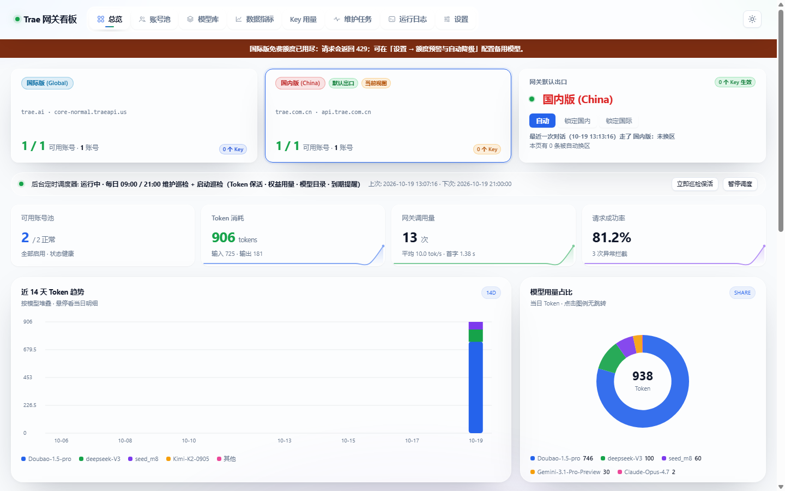
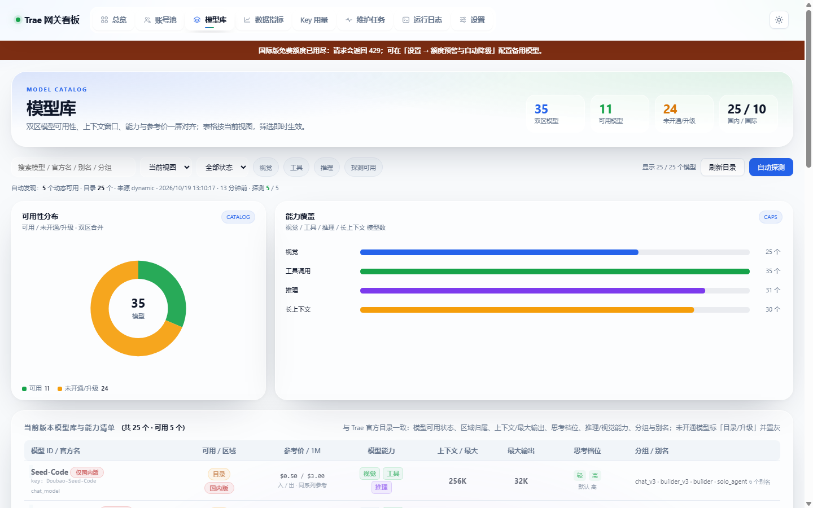
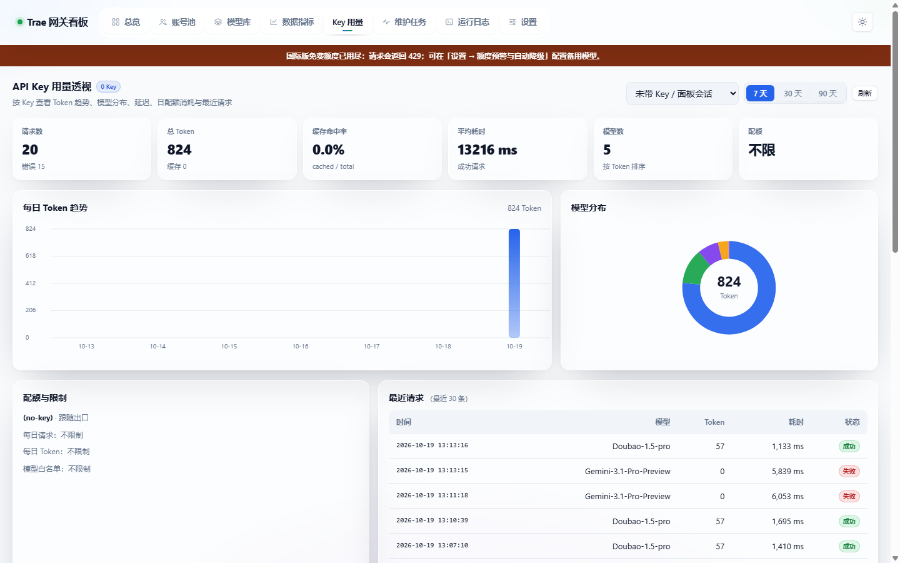
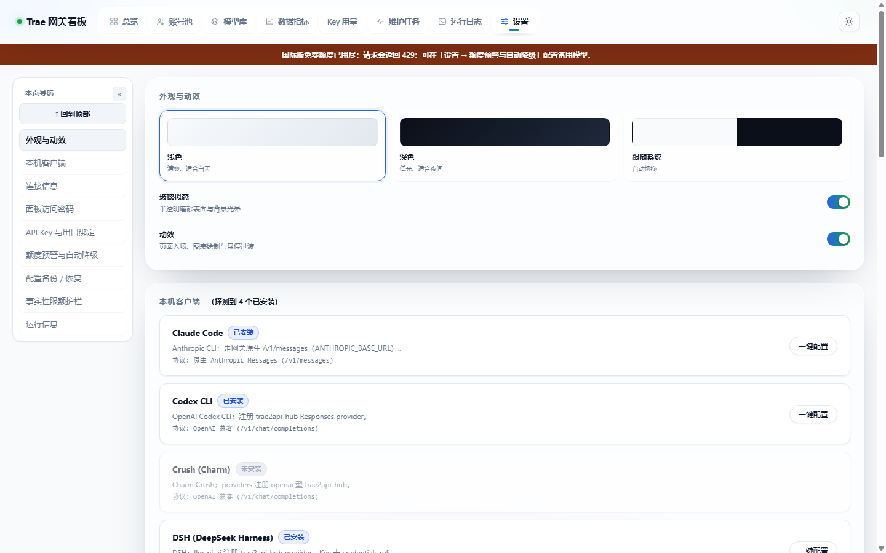

# Trae2API-Hub — 国际版、国内版双区多账号网关中枢

  
  
  
  
  
  
  

**Trae2API-Hub** 把 Trae **国际版**与**国内版**的原生模型服务封装成标准 **OpenAI 兼容 API**，支持 Chat Completions、Responses（Codex / Claude Code）与 Anthropic Messages。项目提供双区账号池、自动换区、模型目录、流式推理、工具调用，以及一套完整的 Web 监控看板。

> **1.1.5 的核心变化：模型状态更准确。** 官方客户端可用、但网关 raw_chat 未接入的模型标为「仅 App」，不再误显示为「不可用」；同 Key 模型行自动去重。 看板现在直接读取 Trae v2 entitlement 的 usage_summary，并同时展示国内版与国际版账号。 看板检测到新版本后会显示顶部徽标与「一键更新」按钮，点击即可下载、备份、替换并自动重启。
>
> **1.0.0 的基础：国际版不再需要 Trae 桌面版。**  
> 修复了旧版本头导致的 `4015` 和错误鉴权方案导致的 `4023`，国际版现在使用当前客户端版本头 + `Authorization: Bearer <access_token>` 直接调用官方 `llm_raw_chat`。**Docker / Linux 无桌面环境可以直接运行**，不需要启动 Trae、调试端口或 `websocket-client`。

---

## 🖼️ 看板预览

**网关总览** — 双区状态、账号池、调度器与实时请求：

**模型库** — 双区模型、上下文/最大输出/思考档位、Free / 升级标记：

**API Key 用量** — 按 Key 的 Token 趋势、模型分布、延迟、日配额与最近请求：

**设置** — API Key、模型白名单、日配额、自动降级、配置备份：

---

## ✨ 功能矩阵

### 双区与直连

- 🌐 **国际版**：`core-normal.traeapi.us`，直接 HTTP，不依赖桌面版
- 🇨🇳 **国内版**：`api.trae.com.cn`，沿用成熟链路
- 🔁 **自动换区**：按模型归属自动路由，显式 `?realm=` / `X-Realm` 永远优先
- 🧠 **模型目录**：国内 25 个 / 国际 10 个（以当前目录快照为准），保留官方展示名、上下文、最大输出、思考档位
- 🔒 **升级模型标记**：Claude Opus/Sonnet、GPT-6/GPT-5.5 等返回 `upgrade_required=true`，不会伪装成“风控”

### 账号与稳定性

- 多账号池、权重、启停、冷却、失败重试与自动轮换
- 双区独立选号，Key 可绑定固定出口
- 会话亲和：同一对话优先固定账号，提升上游 prompt cache 命中
- 额度快照：解析 `notify_usage`，提供 `/quota`、`/v1/quota`
- **额度预警 + 自动降级**：额度耗尽或模型需升级时，自动切到备用模型/出口，响应头 `X-Trae-Degraded`

### API Key 治理

- 多 Key、独立出口、启停、随机生成、掩码展示
- **模型白名单**：`Gemini-*`、`Kimi-*` 等 fnmatch 通配
- **Key 级日配额**：`daily_requests` / `daily_tokens`，0 = 不限制
- 超限 429，模型不匹配 400，均带中文可执行说明
- 按 Key 的用量透视：请求、Token、缓存、平均延迟、模型分布、最近请求

### 协议与客户端

- OpenAI **Chat Completions**：`/v1/chat/completions`
- OpenAI **Responses**：`/v1/responses`（Codex / Claude Code）
- **Anthropic Messages**：`/v1/messages`
- 流式 SSE、`reasoning_content`、工具调用、DSML 回退解析
- 兼容 Cursor、Continue、Cline、Codex、Claude Code、OpenAI SDK 等

### 运维与部署

- 7×24 定时任务：Token 保活、用量刷新、签到、模型探测
- 配置备份 / 恢复：`GET /config/export`、`POST /config/restore`
- 单进程、标准库实现，CN/INTL 推理链路零 pip 依赖
- Docker Compose / GHCR 多架构镜像（amd64 + arm64）
- 玻璃拟态看板：桌面 / 移动端自适应，8 个页签

---

## 🚀 快速开始

### 方式一：本机直接运行（推荐先试）

Windows：

`§bat
start-trae2api-hub.bat
`§

Linux / macOS：

`§bash
chmod +x start-trae2api-hub.sh
./start-trae2api-hub.sh
`§

- API Base：`http://127.0.0.1:8791/v1`
- 看板：`http://127.0.0.1:8791/`
- 面板默认密码：`admin`（登录后请立即修改）

### 方式二：Docker Compose

`§bash
git clone https://github.com/shuishuipingan/trae2api-hub.git
cd trae2api-hub
docker compose up -d --build
docker compose logs -f
`§

- 端口：`8791`
- 持久化：`./accounts`（凭证 / 设置）、`./usage`（用量流水）
- 首次以 LAN 模式启动会生成随机 API Key，打印在日志：

`§bash
docker compose logs trae2api-hub | grep -i "api key"
`§

### 方式三：GHCR 预构建镜像

`§bash
docker pull ghcr.io/shuishuipingan/trae2api-hub:latest

docker run -d --name trae2api-hub --restart unless-stopped \
  -p 8791:8791 \
  -v $(pwd)/accounts:/app/accounts \
  -v $(pwd)/usage:/app/usage \
  -e TZ=Asia/Shanghai \
  ghcr.io/shuishuipingan/trae2api-hub:latest
`§

- 包页面：[GHCR Packages](https://github.com/shuishuipingan/trae2api-hub/pkgs/container/trae2api-hub)
- 版本记录：[Releases](https://github.com/shuishuipingan/trae2api-hub/releases)

---

## 📡 调用示例

### Chat Completions

`§bash
curl http://127.0.0.1:8791/v1/chat/completions \
  -H "Content-Type: application/json" \
  -H "Authorization: Bearer YOUR_API_KEY" \
  -d '{
    "model": "Gemini-3.1-Pro-Preview",
    "messages": [{"role": "user", "content": "用三句话介绍 Trae"}],
    "stream": true
  }'
`§

### OpenAI Python SDK

`§python
from openai import OpenAI

client = OpenAI(
    base_url="http://127.0.0.1:8791/v1",
    api_key="YOUR_API_KEY",
)

resp = client.chat.completions.create(
    model="Doubao-1.5-pro",
    messages=[{"role": "user", "content": "你好"}],
)
print(resp.choices[0].message.content)
`§

### 模型列表

`§bash
curl "http://127.0.0.1:8791/v1/models?realm=intl"
curl "http://127.0.0.1:8791/v1/models?realm=cn"
`§

---

## 🧭 国际版模型与额度

国际版 `/v1/models` 当前目录 10 个，其中 6 个 Free 可用：

| 模型 | 状态 |
|---|---|
| Gemini-3.1-Pro-Preview | ✅ Free |
| Gemini-3-Flash-Preview | ✅ Free |
| Gemini-2.5-Pro | ✅ Free |
| Gemini-2.5-Flash | ✅ Free |
| Kimi-K2-0905 | ✅ Free |
| Grok-4 | ✅ Free |
| Claude-Opus-4.7 | ⬆️ 需升级 |
| Claude-Sonnet-4.6 | ⬆️ 需升级 |
| GPT-5.5 | ⬆️ 需升级 |
| GPT-6-Astra | ⬆️ 需升级 |

官方免费额度用尽时返回 `4008 quota exceeded`，网关统一转成 **HTTP 429** + `Retry-After: 60`，不会冷却账号，也不会伪装成 4015 风控。

`§http
HTTP/1.1 429 Too Many Requests
Retry-After: 60

{
  "error": {
    "type": "quota_exceeded",
    "message": "Trae 免费额度已用尽（4008 quota exceeded）..."
  }
}
`§

查看剩余额度：

`§bash
curl -H "X-Panel-Token: $PANEL_TOKEN" http://127.0.0.1:8791/quota
`§

---

## 🛡️ API Key 配额与模型白名单

设置页「API Key 与出口绑定」每个 Key 支持：

`§json
{
  "name": "Cursor",
  "realm": "intl",
  "models": ["Gemini-*", "Kimi-*"],
  "daily_requests": 200,
  "daily_tokens": 2000000
}
`§

- `models`：大小写不敏感，支持 `*` 通配；空 = 不限制
- `daily_requests`：当日成功请求数；0 = 不限制
- `daily_tokens`：当日成功请求 token；0 = 不限制
- 计数来源：`usage.jsonl`，10 秒缓存，不增加上游调用

---

## 🪂 额度预警与自动降级

设置页可配置：

`§json
{
  "enabled": true,
  "fallback_model": "Doubao-1.5-pro",
  "fallback_realm": "cn",
  "on_quota": true,
  "on_upgrade": true,
  "warn_below": 10
}
`§

触发后自动换模型/出口：

`§http
X-Trae-Degraded: Gemini-3.1-Pro-Preview -> Doubao-1.5-pro (quota)
`§

- 面板顶部显示国际版额度告警
- 账号行显示 `INTL 额度已用尽`
- 自动降级默认关闭，可在设置页显式开启

---

## 💾 配置备份 / 恢复

设置页「配置备份 / 恢复」：

- 一键导出 `settings`（面板密码、API Key、limits、auto_degrade）+ 双区账号凭证
- 恢复前自动写 `accounts/config-backup-<时间>.json`
- 恢复后面板可能需要重新登录

接口：

`§http
GET  /config/export?download=1
POST /config/restore
`§

两者都需要 **面板 token**，不接受普通 API Key。

---

## 🔄 版本检测与一键更新

- 看板加载时强制检查 GitHub 最新 Release；有更新时顶部出现「有新版本 → 一键更新」。
- 设置 → 运行信息也会显示当前版本、最新版本与「一键更新」按钮。
- 点击后自动：下载 release tarball → 安全解压 → 备份到 `update-backups/` → 替换代码 → 重启网关。
- 页面轮询 `/health`，检测到新版本后自动刷新；进度与错误写入 `update.log`。
- 更新过程不会覆盖 `accounts/`、`usage/`、`.git/`、`update-backups/`。

回滚：停止网关，解压最近的 `update-backups/update-*.tar.gz` 覆盖项目目录，再重新启动。

> Docker 部署不支持容器内自更新（重建后文件会丢失）。请使用 `docker compose pull && docker compose up -d`。

## 🐳 Docker 说明

- 镜像内监听 `0.0.0.0:8791`
- 必须挂载 `/app/accounts` 和 `/app/usage`
- `HOST` / `PORT` / `API_KEY` / `TZ` 环境变量可覆盖
- 健康检查：`GET /ping`
- 数据目录 **不要提交到 Git**；`.gitignore` 已排除

---

## 🧱 项目结构

`§text
trae2api-hub/
├── trae_proxy.py          # HTTP 网关、路由、看板 API、SSE
├── trae_client.py         # CN / INTL 上游协议与流式解析
├── trae_accounts.py       # 账号池、凭证、冷却、导出
├── trae_catalog.py        # 双区模型目录与元数据
├── trae_anthropic.py      # Anthropic Messages 适配
├── trae_pricing.py        # 成本估算
├── trae_scheduler.py      # 定时任务
├── trae_tasks.py          # 签到 / 保活 / 刷新
├── dashboard.html         # 看板（8 页签）
├── dashboard-v3.js/.css   # 看板交互与玻璃拟态主题
├── dashboard-charts.js    # 零依赖 Canvas 图表
├── Dockerfile
├── docker-compose.yml
├── docs/img/              # 看板截图
└── .github/workflows/     # 测试 + GHCR 多架构构建
`§

---

## 🧪 自检

`§bash
python _test_trae.py
`§

当前基线：

`§text
PASS=204  FAIL=0  SKIP=0
`§

诊断：

`§bash
python _diag_gateway.py --chat
`§

---

## 🔐 数据与安全

- `accounts/` 内含 token、refresh token、面板密码哈希、API Key；**绝不要提交**
- `usage/` 含请求流水；同样不要提交
- 配置导出文件包含密钥，妥善保管
- 建议生产环境修改默认面板密码、启用 API Key、限制网络入口

---

## 🗺️ Roadmap

- [x] 国际版直连（无桌面 / Docker）
- [x] 双区账号池 / 自动换区
- [x] 模型目录与升级标记
- [x] 额度预警与自动降级
- [x] API Key 日配额 / 模型白名单
- [x] 按 Key 图形化用量页
- [x] 配置一键备份 / 恢复
- [x] 版本检测与一键自动更新
- [ ] 定时配置备份与保留策略
- [ ] Webhook / 飞书 / Telegram 告警
- [ ] 智能成本-延迟路由
- [ ] 多租户账单与预算

---

## Agent 通道（SOLO，1.4.1）

CN 的 SOLO/Agent 模型通过纯 HTTP 通道执行：

    POST https://trae-api-cn.mchost.guru/api/agent/v3/llm_utils_chat
    function = solo_work_lite

这条通道只需要：

    Authorization: Cloud-IDE-JWT <accessToken>
    X-Cloudide-Token / X-Ide-Token / X-Uid
    X-Machine-Id / X-Device-Id

不需要 SQLCipher、不需要 AHA、不需要本机 Trae CN 进程。

### 已接入

    /v1/chat/completions  -> 自动识别 20 个 SOLO 模型
    /v1/agent/chat        -> 显式 Agent 入口

示例：

    curl -X POST http://127.0.0.1:8791/v1/chat/completions \
      -H "Content-Type: application/json" \
      -d "{\"model\":\"deepseek-v4.1-flash\",\"messages\":[{\"role\":\"user\",\"content\":\"只回答好\"}]}"

### 跨设备 / 跨账号

每个账号需要自己有效的 accessToken，以及该账号登录设备的：

    machine_id
    device_id

网关优先从账号 extra 的 machine_id/device_id 读取，其次读环境变量：

    TRAE_DEVICE_ID
    TRAE_MACHINE_ID

因此换设备时把该设备的 device_id/machine_id 写进账号或环境变量即可；换账号时导入该账号自己的 accessToken。不会再依赖本机 App 或 SQLCipher。

### 兼容层

旧的 UI/AHA 桥还保留在 tools/trae_ui_agent.mjs，只有在设置：

    TRAE_AGENT_UI_FALLBACK=1

且本机 Trae CN 以 CDP 9335 启动时才作为 fallback 使用。

### 边界

没有有效 CN accessToken，或 device_id/machine_id 与该账号设备不匹配时，SOLO 通道会被上游拒绝。这不是无账号方案。

---

## 📄 License

[MIT](LICENSE)

> Trae 是其所属公司的商标。本项目为个人学习与自托管网关实践，与官方无隶属关系；请遵守你所在地法律及官方服务条款，仅使用你拥有合法访问权的账号。
